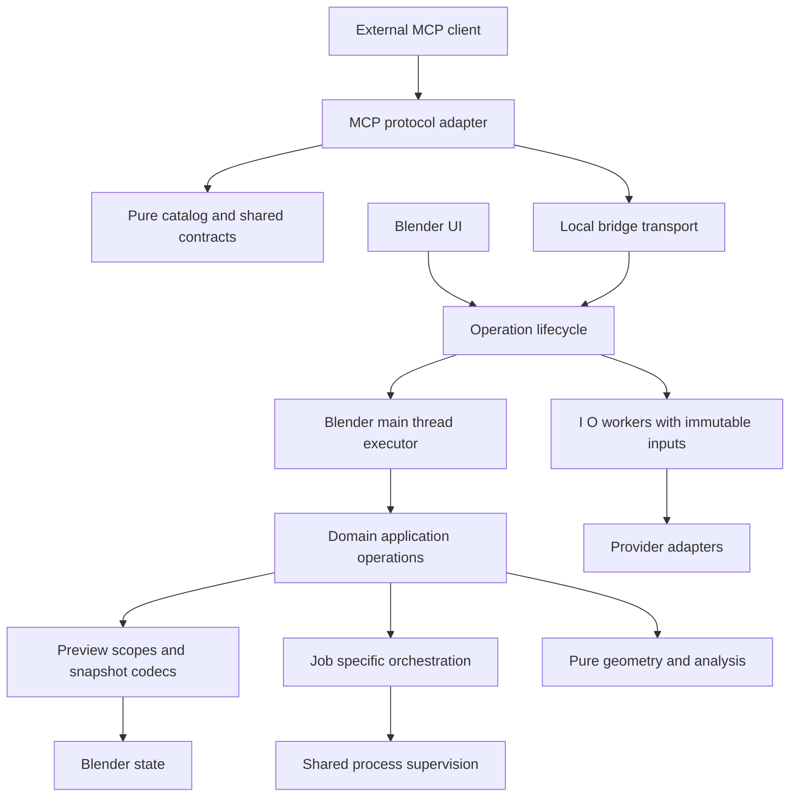

# Blender Agent Bridge architecture review

Blender Agent Bridge has a sound product boundary: external clients own the agent, while Blender owns scene access, execution trust, previews, and evidence. Keep that boundary. The most valuable improvements concern operation recovery and consistent ownership inside the extension.

Review and plan, 11 October 2026. Nine prioritized findings: four high impact runtime risks and five medium impact structural or verification issues. Begin with the recovery fixes and characterization tests; broad module movement should follow those proofs. No implementation changes were made for this review.

The subsequent implementation and verified results are documented in [Architecture improvements implemented](ARCHITECTURE_IMPLEMENTATION_2026-10-11.md).

**Scope and baseline**

The review covers the `blender-claude-plugin` repository at `140f831`, including its existing working-tree documentation changes. The architectural inventory covers all 135 add-on Python modules, totaling 86,243 source lines, plus packaging, CI, documentation, and tests. The registry contains 241 contracts across 13 domains and advertises 240 canonical helper definitions. There are 58 unit-test files and 46 smoke-test files.

Every source module was inventoried and parsed; execution paths and ownership boundaries were traced selectively in depth. This is a system architecture review, not a claim that every geometry algorithm or every tool behavior received exhaustive verification. Adjacent Blender scene files, one-off workspace scripts, and the separate TripoSR checkout are outside the product review.

The existing uncommitted documentation and parked stash were left intact. No live user scene, provider account, or published release was changed.

**Current responsibility map**

| Area | Present owner and execution model | Assessment |
| --- | --- | --- |
| Product and client boundary | External agents launch `mcp_runtime/server.py`, which enters `mcp_server.py`; Blender hosts the localhost bridge | Preserve the process boundary and provider neutrality |
| Public contracts | `tool_registry` owns schemas, handler keys, order, safety metadata, groups, and digest; `tool_surface` selects exposure | Strong foundation; derive more discovery policy from this owner |
| Transport and execution | HTTP threads enqueue work; the Blender timer runs `tool_executor` and domain handlers | Correct location for `bpy`; missing request lifecycle and execution-lane distinctions |
| Preview and rollback | `live_preview` owns one pending transaction; helpers contribute snapshots and mutations | Useful isolation primitives exist, but use and snapshot ownership vary |
| Trusted scripts and project files | `script_runner`, `script_execution`, `trusted_script_jobs`, and `project_files` enforce session trust and checkpoint paths | Preserve binary trust and explicit result replacement; improve process supervision |
| Jobs and generated assets | `asset_jobs`, `asset_job_worker`, provider clients, generation policy, and spend approvals | Generation correctly reuses asset jobs; worker dispatch and process mechanics still have multiple owners |
| Modeling and references | Pure shape, field, fitting, mask, and multiview modules feed Blender scene adapters | Preserve this separation; expand behavioral CI coverage |
| Animation and simulation | Brief/planning modules, Blender analysis, animation runtime, and bounded helper modules | Keep workflow orchestration distinct from generic execution; characterization is more valuable than splitting by file size |
| Materials, rigging, presentation, camera | Domain helpers apply changes through preview snapshots and Blender compatibility helpers | Preserve domain cohesion; migrate rollback knowledge into explicit snapshot APIs |
| Context and documentation | Scene/world inspection, context budgets/planning, local documentation indexes, response controls | Good progressive disclosure; response reduction currently saves payload size after full inspection has run |
| Captures and observability | Project/session capture roots, resource URIs, traces, reviews, benchmarks, audit logs | Preserve local evidence and redaction; carry operation IDs across MCP, bridge, jobs, and traces |
| Preferences and UI | Session credentials, OS credential store, preferences, compact sidebar/operators | No basis for a UI rewrite; preserve explicit credential persistence and trust controls |
| Lifecycle and distribution | Manual reload inventories; extension ZIP, zero-dependency Python runtime, MCPB, artifact identity checks | Distribution checks are substantial; reload and test inventories need completeness checks |

**1. High impact, confirmed: timed-out queued requests still execute**

Classification: bug/risk fix, followed by a behavior-affecting request lifecycle improvement.

[bridge_server.py:866](C:/Users/Michael/Documents/blend/blender-claude-plugin/addon/claude_blender/bridge_server.py:866) enqueues a callable and waits for an event. A timeout only stops the wait. [The timer at line 877](C:/Users/Michael/Documents/blend/blender-claude-plugin/addon/claude_blender/bridge_server.py:877) subsequently executes every queued callable without checking whether its caller timed out. The queue is unbounded, and each timer invocation drains it without a time budget. Status records retain the active and last operation, identified by tool name rather than a request ID.

A probe using the actual queue functions produced `queued=1, effects=[]` after timeout, then `effects=['mutation']` after pumping the queue. A client that retries after an ambiguous failure can therefore cause duplicate changes. Stopping the HTTP listener also leaves queued work available for the timer to drain.

Smallest correction: give each queued request an identity, deadline, and explicit queued/running/finished state. Expire work that has not started, distinguish running work from cancelled work, retain a bounded result record, and cap admissions and work per timer tick. Propagate the operation ID into traces. Preserve the current timeout fields while adding precise recovery information. Do not attempt to interrupt arbitrary running `bpy` code.

Proof: expired-before-start requests never invoke their callable; already-running work remains queryable; repeated operation IDs do not mutate twice; bridge shutdown resolves pending requests. Existing timeout warnings are useful counter-evidence, but they do not resolve queued requests or recover their results.

**2. High impact, confirmed: failed helpers are not atomic inside an existing preview**

Classification: bug/risk fix, then a structural refactor of snapshot ownership.

[live_preview.begin at line 383](C:/Users/Michael/Documents/blend/blender-claude-plugin/addon/claude_blender/live_preview.py:383) reuses a pending transaction. [handler_runtime.py:234](C:/Users/Michael/Documents/blend/blender-claude-plugin/addon/claude_blender/handler_runtime.py:234) reverts a failed tool only when it created a new transaction. When an earlier preview exists, it preserves the whole transaction, including changes made by the failed call.

In factory-startup Blender, a successful move placed the cube at X=1. A second move with an injected exception after mutation returned `ok=false` and `auto_reverted_preview=false`, but left the cube at X=3. This is an observed failure-path defect; the exception was deliberately injected, rather than encountered in ordinary use.

Smallest correction: use the existing `begin_isolated` / `finish_isolated` / `abort_isolated` pattern for each preview mutation. Successful calls still merge into the existing preview; failure restores the state immediately before that call. Newer sculpt, reference, and remesh operations already demonstrate this pattern. Exempt commit/revert, file replacement, and checkpoint-only scripts from generic wrapping.

Then define explicit snapshot record/restore interfaces. Today 22 modules contain 323 references to private `live_preview` attributes, and domain code directly authors `before_state` records. For example, [advanced_support.py:66](C:/Users/Michael/Documents/blend/blender-claude-plugin/addon/claude_blender/advanced_support.py:66) serializes material state while [live_preview.py:1671](C:/Users/Michael/Documents/blend/blender-claude-plugin/addon/claude_blender/live_preview.py:1671) restores many domain-specific shapes. A snapshot change requires coordinated edits in both locations.

Proof: inject failures before and after mutation, with and without a parent preview; earlier successful edits remain, failed-call edits disappear, manifests retain their meaning, and mesh snapshot datablocks are released. Keep existing restore ordering, including mesh and vertex-group dependencies.

**3. High impact, confirmed: network and process waits run on Blender's main thread**

Classification: runtime risk and execution-boundary redesign.

Every tool currently enters the same main-thread executor. [External asset search handlers](C:/Users/Michael/Documents/blend/blender-claude-plugin/addon/claude_blender/tool_handlers/external_assets.py:9) synchronously call network functions such as [search_poly_haven_assets](C:/Users/Michael/Documents/blend/blender-claude-plugin/addon/claude_blender/external_assets.py:883), with configurable waits up to 60 seconds. [Generation diagnostics](C:/Users/Michael/Documents/blend/blender-claude-plugin/addon/claude_blender/tool_handlers/generation.py:43) can run a hardware probe through a blocking subprocess call with a 60-second timeout. [Remote Meshy cancellation](C:/Users/Michael/Documents/blend/blender-claude-plugin/addon/claude_blender/tool_handlers/generation.py:520) also performs HTTP before cancelling the local worker.

These paths block UI and queued scene operations for the duration of external waits. Existing asynchronous download and generation jobs reduce the problem, but do not cover ordinary catalog searches, initial hardware probes, or remote cancellation. No live provider latency was measured in this review.

Smallest correction: snapshot preferences, authorization, and immutable inputs on the main thread; perform pure network/process work on a worker; marshal only scene reads or changes back to Blender. Preserve synchronous public result shapes for short searches where possible. For longer probes, return cached data or a pollable job. Keep worker execution explicitly declared rather than inferring it from `readOnly` metadata: many read-only tools still require `bpy`.

Proof: a deliberately delayed fake provider must not stop a Blender timer heartbeat or an independent scene-status request; confirm no worker reads Blender preferences or scene objects directly. Preserve spend approval, reference identity checks, egress policy, and remote-cancellation reporting.

**4. High impact, confirmed: job cancellation has diverged across implementations**

Classification: bug/risk fix, followed by a structural refactor.

[asset_jobs.py:799](C:/Users/Michael/Documents/blend/blender-claude-plugin/addon/claude_blender/asset_jobs.py:799) uses the process-tree supervisor. [trusted_script_jobs.py:315](C:/Users/Michael/Documents/blend/blender-claude-plugin/addon/claude_blender/trusted_script_jobs.py:315) launches without the shared process-group options, and [cancel_job at line 439](C:/Users/Michael/Documents/blend/blender-claude-plugin/addon/claude_blender/trusted_script_jobs.py:439) terminates only its direct process. Render jobs similarly duplicate launch, PID detection, cancellation, and shutdown mechanics. Asset jobs even import private environment and PID helpers from `render_jobs`.

A disposable parent/child probe using the current trusted-script cancellation function returned success with the parent stopped and the child still alive. The probe cleaned up its own child afterward. Thus a trusted script that launches another process can leave work running after cancellation. Shutdown paths in render and trusted-script jobs also terminate without consistently waiting or escalating.

Smallest correction: first adopt `process_group_kwargs` and `terminate_process_tree` together for trusted-script and render jobs. Then share process supervision, atomic status writing, and liveness mechanics. Keep job-specific operations separate: applying a script result, importing an asset, and assembling video have different contracts. Preserve existing job metadata formats and resource URIs through adapters.

Proof: cancel and unregister stop parent and descendants; resistant processes are escalated and reaped; completion/cancellation races preserve terminal state; recovered jobs never kill an unrelated process solely because a PID was reused. Retain provider-specific remote cancellation semantics.

**5. Medium impact, confirmed: discovery policy is split between registry metadata and name heuristics**

Classification: structural refactor, with separately reviewed discovery corrections.

The registry owns domain and group metadata, but [mcp_server.py:1590](C:/Users/Michael/Documents/blend/blender-claude-plugin/addon/claude_blender/mcp_server.py:1590) reconstructs categories through hard-coded names and substrings. Its [448-line scoring function](C:/Users/Michael/Documents/blend/blender-claude-plugin/addon/claude_blender/mcp_server.py:1906), [agent_tools selection](C:/Users/Michael/Documents/blend/blender-claude-plugin/addon/claude_blender/agent_tools.py:286), and `helper_routing` each participate in discovery policy.

An observed mismatch: `plan_image_to_3d_approach`, `cleanup_generated_asset`, and `evaluate_generated_asset` belong to generation/external-asset registry groups but receive category `other` in MCP discovery. Category filters and ranking therefore do not consistently reflect the canonical grouping. Exact-name lookup remains available, so this does not make those tools uncallable.

Smallest correction: extract a pure catalog/ranking module and use an explicit mapping from registry groups to the existing public category vocabulary. Keep gateway names and result shapes stable. MCP should own protocol translation, bridge calls, and serialization; the catalog module should own ranking and categories. Move the small shared bridge client out only where it removes transport coupling, including diagnostics' lazy imports from the server.

Proof: replay the existing routing corpus and compare ordered results for gateway, direct, and full surfaces. Approve changed rankings separately from the extraction. Do not merge schema-budget selection and catalog ranking into one algorithm unless their distinct behavior is preserved.

**6. Medium impact, confirmed: MCP and raw bridge schema validators disagree**

Classification: structural refactor plus validation behavior correction.

[mcp_server.py:1138](C:/Users/Michael/Documents/blend/blender-claude-plugin/addon/claude_blender/mcp_server.py:1138) and [bridge_protocol.py:220](C:/Users/Michael/Documents/blend/blender-claude-plugin/addon/claude_blender/bridge_protocol.py:220) implement separate JSON Schema subsets. MCP's validator omits numeric bounds and combinators implemented by the bridge. Against the same integer schema with minimum 1 and maximum 100, MCP accepted 0 and 101 while the bridge rejected both.

Raw bridge validation still blocks these malformed scene calls, so this finding is not an authorization bypass. The demonstrated costs are inconsistent rejection behavior and duplicated validator maintenance; MCP-local gateway arguments also use the weaker validator.

Smallest correction: one dependency-free schema validator, used by both transports, with explicit support for the keywords actually present in the registry. Keep validation at both boundaries while sharing the implementation. Preserve diagnostic paths and useful accepted-property hints; review earlier rejection and stricter gateway validation as behavior changes.

Proof: run the same valid/invalid corpus through both entry points, including numeric limits, non-finite numbers, arrays, nested objects, and combinators. Assert that invalid requests do not reach a handler. Delete the duplicate validator after migration.

**7. Medium impact, confirmed: provider execution is duplicated between worker modes**

Classification: structural refactor.

[asset_jobs.py:655](C:/Users/Michael/Documents/blend/blender-claude-plugin/addon/claude_blender/asset_jobs.py:655) contains an in-process branch tree for Poly Haven, Sketchfab, and generation providers. [asset_job_worker.py:166](C:/Users/Michael/Documents/blend/blender-claude-plugin/addon/claude_blender/asset_job_worker.py:166) separately owns a dispatch table and argument adaptation for the same sources. The optional in-process mode is reachable through an environment setting, so it is not dead code. Validation/redaction additionally lives in `JOB_PROVIDER_SPECS`.

Adding or changing a provider requires keeping both execution paths synchronized. The worker table is already a useful boundary, and generation correctly shares the asset-job lifecycle; retain both decisions.

Smallest correction: extract one pure provider execution function accepting validated inputs, explicit credentials, and progress/cancellation callbacks. Both worker modes call it. Keep capability descriptions, spend approval, provider-specific option policy, and scene import separate where they enforce different invariants. Avoid a generalized plugin framework.

Proof: run identical fake-provider cases through both modes and compare manifests, progress, failures, redaction, and cancellation. Delete the duplicated branch tree after redirecting its caller.

**8. Medium impact, confirmed: the reload inventory omits active implementation modules**

Classification: lifecycle refactor with a stale-code correctness consequence.

[__init__.py:44](C:/Users/Michael/Documents/blend/blender-claude-plugin/addon/claude_blender/__init__.py:44) manually enumerates modules, and [the loader at line 159](C:/Users/Michael/Documents/blend/blender-claude-plugin/addon/claude_blender/__init__.py:159) reloads only those entries plus the explicit handler/runtime list. Active dependencies such as `reference_image_intake`, `reference_image_masks`, `generation_job`, `generation_clients`, `response_controls`, and `script_execution` are absent. Reloading their consumers does not reload these already-imported modules.

[Reload inventory tests](C:/Users/Michael/Documents/blend/blender-claude-plugin/tests/unit/test_reload_inventory.py:26) check domains and handlers, but do not establish completeness for the remaining implementation graph. Development reload can therefore combine updated callers with old implementations.

Smallest correction: keep deterministic ordering, add explicit classifications for reloadable implementation, subprocess-only code, and intentionally persistent session state, and require every shipped module to have a classification. Reload actual implementation dependencies in order. Preserve credential state deliberately; do not indiscriminately reload all modules or introduce dynamic plugin discovery.

Proof: change a sentinel implementation in a disposable fixture, reload, and verify a real handler observes it. Also verify trust policy, credentials, handlers, timers, and process cleanup across unregister/register. Remove redundant inventories where a single declaration can generate them.

**9. Medium impact, confirmed: the tagged smoke suite is not the full deterministic suite**

Classification: verification architecture improvement.

[mcp-smoke.yml:256](C:/Users/Michael/Documents/blend/blender-claude-plugin/.github/workflows/mcp-smoke.yml:256) maintains separate ordinary and tagged Blender smoke arrays. Seven deterministic feature smokes are absent from both: `smoke_adaptive_manifold`, `smoke_generated_manifest_evaluation`, `smoke_modeling_quality_gate`, `smoke_reference_image_intake`, `smoke_reference_part_graph`, `smoke_shape_program`, and `smoke_user_functionality_pov`. They are not invoked indirectly by another test or script in the checked execution paths.

The existing unit suite, three-version Blender matrix, installed-extension smoke, and artifact identity checks are substantial. The gap is specific: new modeling and user-workflow regressions can bypass automated release coverage despite already having dedicated tests. Optional live-provider and real external-manifest smokes should remain explicitly separate.

Smallest correction: one checked test manifest records execution environment, deterministic/live classification, fixture needs, and normal/release lanes. CI and local runners consume it. Fail a lightweight inventory check when a test is neither assigned to a lane nor explicitly excluded with a reason. Retain the documented Blender version matrix and tagged installed-extension gate.

Proof: all 46 smoke files are classified; every deterministic Blender smoke enters a release lane; required suites assert their success sentinel and propagate failure. Keep import-boundary tests, and supplement source-string assertions with lifecycle and failure-path tests.

**Recommended implementation order**

Each row is an independently reviewable slice. Revert the individual slice if its preservation checks fail; do not leave competing production paths behind a permanent migration flag.

| Order | Slice and ownership change | Contract to preserve and proof | Stopping point and obsolete path |
| --- | --- | --- | --- |
| 1 | Add queue-expiry, parent-preview failure, descendant-cancel, and smoke-inventory characterization | Establish the failures above without rewriting existing assertions | Tests and fixtures only; no production routing change |
| 2 | Put request lifecycle between HTTP/MCP adapters and the main-thread queue | Keep existing tools and timeout fields; test expiry, retained results, shutdown, and retry identity | One queue owner; remove bare callable-only requests |
| 3 | Apply isolated preview operations, one helper family at a time; pair snapshot capture and restoration | Successful calls merge exactly as before; failures restore only their own work; verify manifests and restore order | Finish each family and remove its direct snapshot dictionary writes |
| 4 | Move shared launch/stop/liveness mechanics into process supervision | Keep job IDs, metadata, resources, checkpoints, and apply/import decisions; test descendant cleanup and exit races | Migrate trusted scripts, then renders; remove private imports from `render_jobs` |
| 5 | Move network/probe work to an explicit I/O execution lane | Snapshot authorization first; retain provider policy and public results; test UI heartbeat during blocked I/O | One path per migrated operation; remove its synchronous external wait from Blender's timer |
| 6 | Share schema validation; extract pure catalog policy in a separate change | Preserve five gateways, exact names, schema snapshots, and ranking unless deliberately corrected | Delete duplicate validator and old category/ranking implementation |
| 7 | Share provider execution across subprocess and in-process modes | Preserve spend decisions, secrets, reference hashes, manifests, and progress order | Delete duplicate provider branch tree |
| 8 | Classify reload modules and smoke tests; update architectural documentation | Verify reload behavior, session state, all smoke assignments, packaging, and registry parity | Replace redundant hand-maintained inventories where practical |

Slices 2, 3, 4, and 5 intentionally improve behavior and require focused regression evidence. Slice 6 should separate a mechanical extraction from stricter validation or ranking changes. Provider extraction and documentation/inventory cleanup can otherwise preserve existing behavior.

**Target dependency direction**

These are responsibility boundaries, not a requirement to move every existing file or introduce service classes. The pure geometry/scene-adapter split already approximates the desired direction.

**Preserve and defer**

Preserve the canonical registry, five gateway surface, pure geometry modules, Blender compatibility adapter, session credential policy, explicit paid-generation approvals, project/session evidence paths, and tested release-artifact identity. Preserve bundled and standalone MCP compatibility and the rule that ordinary Python runtime imports must work without Blender.

A second agent runtime, microservices, a database, an event bus, and a wholesale folder reorganization have no demonstrated benefit for these findings. Large files such as `animation_analysis.py` do not earn a split solely through length. Move individual responsibilities when their invariants, dependency requirements, or test needs justify it.

Treat documentation refresh as low-risk housekeeping after ownership is settled. For example, `docs/ARCHITECTURE.md` still describes eleven registry domains while the live registry has thirteen, and the generation ADR retains proposed/early-implementation language. Update those statements from the registry and completed decisions without revisiting the established provider-neutral product scope.

**Verification evidence and limits**

- Python 3.13 unit suite: **579 run, 577 passed, 2 skipped**. The first sandboxed attempt failed on temporary-directory and localhost permissions; the unrestricted rerun passed.
- Blender 5.1.2 in separate factory-startup processes: **`smoke_live_helpers`, `smoke_safe_editing_helpers`, `smoke_bridge_server`, and `smoke_trusted_script_jobs` passed**.
- Review probes confirmed late execution after queue timeout, partial mutation surviving a failed call inside a parent preview, inconsistent numeric validation, generation tools categorized as `other`, and a surviving subprocess descendant after trusted-job cancellation.
- All 135 add-on Python modules parsed successfully. `git diff --check` passed before the review document was added.
- Evidence logs and the two Blender/process probe scripts are in `.dev-session/architecture-*`. The queue and validator probes executed directly from the current source without implementation edits.
- No new provider calls, release publication, manual UI testing, full smoke matrix, or Blender 4.2/4.5 execution was performed. The recommended fixes remain unimplemented.
